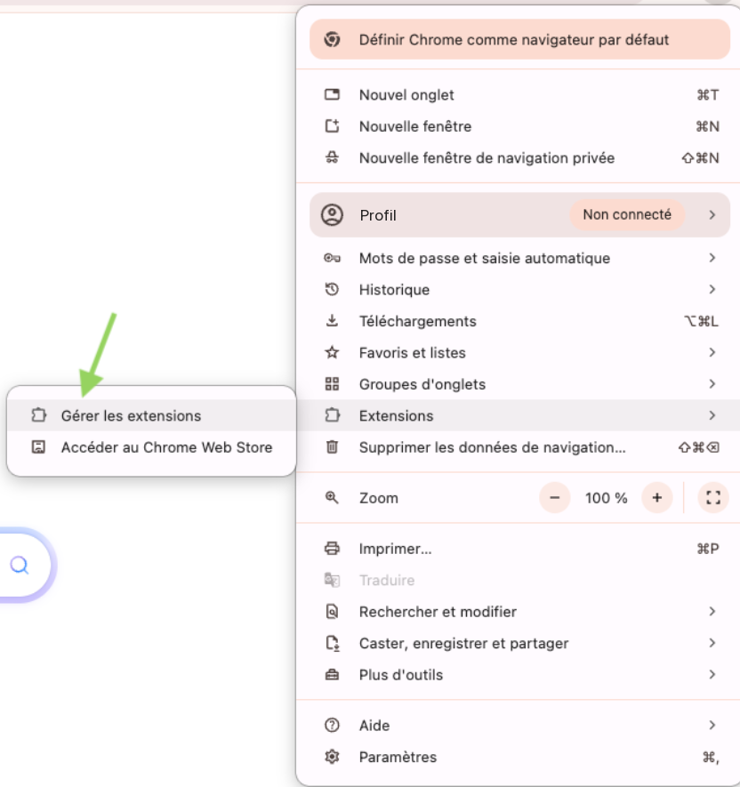
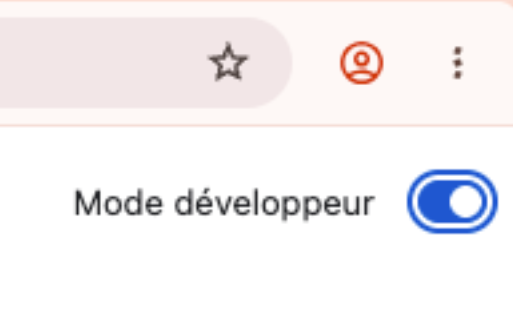
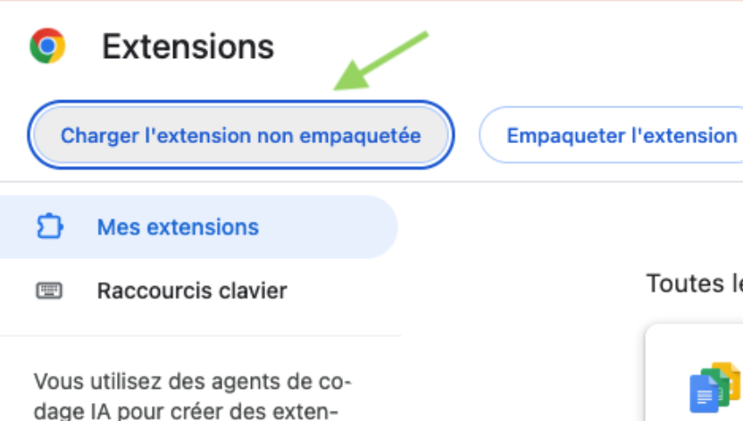
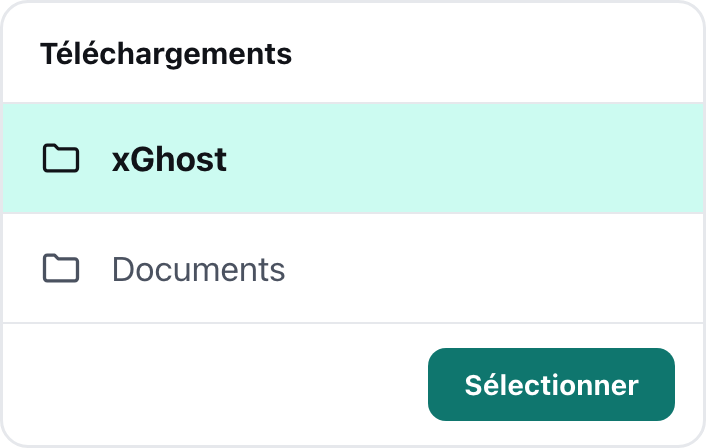
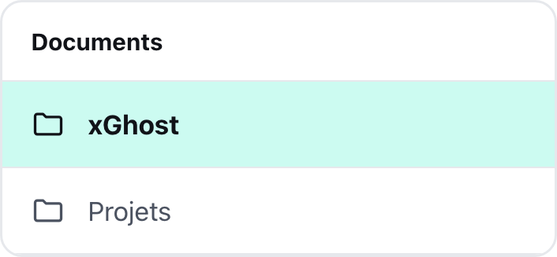
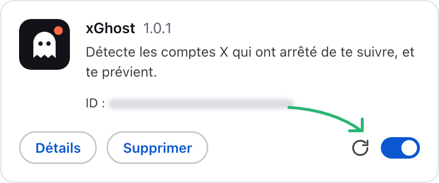

<p align="center">
  
</p>

<h1 align="center">xGhost</h1>

<p align="center">
  Détecte les comptes X qui ont arrêté de te suivre, et te prévient.<br />
  Extension pour Chrome et les navigateurs compatibles (Brave, Edge, Arc…).
</p>

<p align="center">
  <a href="https://app-buildr.github.io/xghost/"><strong>Site et guide d'utilisation</strong></a> ·
  <a href="https://github.com/app-buildr/xghost/releases/latest/download/xghost.zip">Télécharger</a>
</p>

<p align="center">
  
</p>

## Documentation

Tout est expliqué, captures à l'appui, sur le site de l'extension :
**[app-buildr.github.io/xghost](https://app-buildr.github.io/xghost/)**

- [Présentation](https://app-buildr.github.io/xghost/) : à quoi sert l'extension, en images
- [Installation](https://app-buildr.github.io/xghost/#installation) : le tutoriel pas à pas
- [Mise à jour](https://app-buildr.github.io/xghost/#mise-a-jour) : installer une nouvelle version

## Fonctionnalités

- **Départs** : la liste des comptes qui ont arrêté de te suivre, avec la date. Un départ garde
  l'étiquette « Nouveau » jusqu'à ce que tu quittes la page.
- **Nouveaux abonnés** : les arrivées, dans un panneau à part. Les deux listes se filtrent sur les
  **follow back** (les comptes que tu suis aussi).
- **Graphique sur 30 jours** : arrivées et départs jour par jour, détail au survol.
- **Vérifications automatiques** : xGhost contrôle tes abonnés à intervalles réguliers, sans que tu
  aies à y penser. **Vérifier maintenant** lance un contrôle à la demande.
- **Alertes** : un badge sur l'icône et une notification groupée par vérification.
- **Plusieurs comptes** : chaque compte X connecté est suivi séparément, avec ses propres départs.
  Des comptes peuvent être ignorés, et « Uniquement les follow back » se règle compte par compte.
- **Historique complet**, gardé sur ton ordinateur.
- **Sauvegarde** : exporte toutes tes données dans un fichier, et réimporte-les après une
  réinstallation ou sur un autre ordinateur (Réglages → Sauvegarde).
- **Français et anglais**, selon la langue de ton navigateur.
- **Aucune requête envoyée à X** : xGhost ouvre x.com dans un onglet et lit simplement ce que la
  page reçoit. Tes autres onglets x.com ne sont pas touchés, et rien ne quitte ton navigateur.
- **Mises à jour** : une flèche ↑ sur l'icône et un bandeau préviennent quand une nouvelle version
  est disponible.

| Popup | Pendant un scan complet |
| :---: | :---: |
|  |  |

## Installation

xGhost ne passe pas par le Chrome Web Store : on le charge en **mode développeur**, une option
standard de Chrome. Compte deux minutes.

1. [**Télécharge xGhost (.zip)**](https://github.com/app-buildr/xghost/releases/latest/download/xghost.zip),
   puis décompresse l'archive. Range le dossier `xGhost` dans un endroit où il restera, par exemple
   `Documents` : le navigateur en a besoin en permanence.
2. Ouvre `chrome://extensions` (`brave://extensions` ou `edge://extensions` selon ton navigateur),
   ou menu **⋮** → **Extensions** → **Gérer les extensions**.

   
3. Active le **Mode développeur**, en haut à droite.

   
4. Clique sur **Charger l'extension non empaquetée**, puis choisis le dossier `xGhost` (celui qui
   contient `manifest.json`).

   
   
5. Épingle l'icône : pièce de puzzle à droite de la barre d'adresse, puis l'épingle à côté de xGhost.
6. Connecte-toi à [x.com](https://x.com/login) si ce n'est pas déjà fait, puis suis l'accueil de
   l'extension : le premier scan enregistre tes abonnés actuels.

## Mise à jour

Chargé en mode développeur, xGhost n'est pas mis à jour par Chrome. Il vérifie donc lui-même,
plusieurs fois par jour, si une nouvelle version est publiée : une **flèche ↑** apparaît sur son
icône et un bandeau s'affiche en haut des options et de la popup. Pas besoin de tout réinstaller :
tes comptes, ton historique et tes réglages sont conservés. Par précaution, tu peux d'abord
exporter une sauvegarde (Réglages → Sauvegarde).

1. [**Télécharge la nouvelle version (.zip)**](https://github.com/app-buildr/xghost/releases/latest/download/xghost.zip),
   puis décompresse-la.
2. Remplace l'ancien dossier `xGhost` par le nouveau, **au même endroit et sous le même nom** : le
   navigateur retrouve l'extension, et tes données, grâce à l'emplacement du dossier.

   
3. Ouvre `chrome://extensions` et clique sur la flèche circulaire de la carte xGhost. Le numéro de
   version change et la flèche ↑ disparaît.

   

## Confidentialité

- Aucune donnée envoyée à un serveur tiers : pas de compte xGhost, pas d'API payante.
- Aucune requête maison vers X, aucun cookie conservé (xGhost vérifie seulement que tu es connecté).
- Toutes les données restent sur ton ordinateur (stockage local de l'extension). Rien n'est
  synchronisé : pour les garder ou les transférer, utilise l'export de sauvegarde. Le fichier
  contient la liste de tes abonnés, garde-le pour toi.
- Seule autre connexion : la lecture du numéro de la dernière version publiée sur GitHub.

xGhost est un outil non officiel, sans lien avec X Corp.

---

# Développement

Extension Chrome Manifest V3 en TypeScript, construite avec [WXT](https://wxt.dev), interface en
React.

## Démarrer

```bash
pnpm install
pnpm dev        # Chrome avec l'extension chargée et rechargement à chaud
```

## Commandes

| Commande         | Rôle                                                       |
| ---------------- | ---------------------------------------------------------- |
| `pnpm dev`       | mode dev (WXT), rechargement à chaud                       |
| `pnpm build`     | build de production dans `dist/`                           |
| `pnpm package`   | build puis archive `xghost.zip` (dossier `xGhost`)         |
| `pnpm release`   | publie une release GitHub (script local `release.sh`)      |
| `pnpm test`      | tests unitaires (Vitest)                                   |
| `pnpm typecheck` | vérifie les types                                          |
| `pnpm icons`     | régénère les icônes PNG (normale, scan, déconnecté)        |

Charger le build à la main : `chrome://extensions` → mode développeur → « Charger l'extension non
empaquetée » → `dist`.

Le site (`docs/`) est publié par GitHub Pages (branche principale, dossier `/docs`).

## Publier une nouvelle version

1. Monte la version dans `package.json` (elle devient celle du manifeste), par exemple `1.0.1`,
   puis committe et pousse sur `main`.
2. `pnpm release` (ou `pnpm release "Notes de version"`) : vérifie les types et les tests, produit
   `release/xghost.zip` (dossier `xGhost/`) et, après confirmation, publie la release `v1.0.1` avec
   l'archive jointe. `pnpm release --dry-run` prépare le zip sans rien publier.

Le nom de l'archive doit rester `xghost.zip` : c'est lui que pointent les liens « Télécharger ».
`release.sh` est un script local, ignoré par git (il utilise `gh`, connecté au compte qui publie).

Les extensions installées relèvent la release `latest` (API GitHub) au démarrage, toutes les
6 heures et à l'ouverture des options (`features/updates`). Pour tester l'alerte sans publier :
`FAKE_LATEST_VERSION=9.9.9 pnpm build`.

## Architecture (par fonctionnalité)

```
src/
├── entrypoints/           # WXT : background, scripts x.com (page + isolé), popup, options, onboarding
├── features/
│   ├── x-api/             # session (cookies), lecture et validation des réponses GraphQL de x.com
│   ├── followers-sync/    # moteur de scan par onglet, instantanés, profils, estimation du temps restant
│   ├── hidden-render/     # rendu simulé de l'onglet de scan quand il est caché
│   ├── scan-veil/         # overlay de l'onglet de scan (titre, favicon de progression)
│   ├── unfollow-detection/# comparaison, contrôle léger, arrêt anticipé, garde-fous, réparation de l'historique
│   ├── events/            # historique (format compact), sélecteurs, commandes + listes départs/arrivées (ui/)
│   ├── accounts/          # comptes suivis (multi-comptes), comptes ignorés
│   ├── settings/          # réglages (modèle, stockage, interface)
│   ├── scheduler/         # alarmes, ajout automatique des comptes
│   ├── alerts/            # badge/icône et notifications
│   ├── backup/            # sauvegarde : export, validation stricte, import atomique, verrou
│   ├── app-state/         # hooks React d'accès aux données (état global, compte, « vu à l'affichage »)
│   ├── scan-status/       # textes et composants d'état du scan partagés
│   ├── updates/           # vérification des nouvelles versions (releases GitHub) + bandeau
│   └── dashboard/ popup/ options/ onboarding/   # écrans
└── shared/                # stockage local (+ conversion des sauvegardes 1.0), i18n, messagerie typée, composants, utilitaires
```

Le service worker est le seul à écrire. Les interfaces lisent le stockage directement et envoient
leurs commandes par messages typés (`shared/messaging/protocol.ts`), acceptés uniquement depuis les
pages de l'extension.

Tout est dans `chrome.storage.local` (la synchronisation Chrome, limitée à 100 Ko, a été
abandonnée). Pas de migration automatique des données de la 1.0 : on les récupère en réimportant
une sauvegarde 1.0, convertie à l'import (`shared/storage/legacy.ts`).

## Traductions

Les textes sont dans `src/shared/i18n/locales/<langue>/*.json` (un fichier par domaine), traduits
avec [i18next](https://www.i18next.com) : `t('clé', { variables })`, pluriels `_one` / `_other`.
La langue suit celle du navigateur (anglais par défaut). Les clés sont typées sur le français, un test
vérifie que l'anglais a les mêmes clés et variables, et un autre qu'aucun texte n'est écrit en dur
dans le code. Nom et description de l'extension : `public/_locales`.

## Récupération des abonnés

xGhost n'envoie **aucune requête** à X (pas de forge d'en-tête anti-bot). Il ouvre x.com et lit les
réponses que la page reçoit elle-même.

- **Onglet de scan** ouvert avec le fragment `#xghost` : seul cet onglet est instrumenté. Le script de
  page (monde MAIN) y lit les réponses `Followers`, `UserByScreenName` et `UserByRestId`, et les
  transmet au script isolé par un `MessageChannel` privé, échangé avant tout code de x.com. Les autres
  onglets x.com ne sont pas touchés.
- **Contrôle léger** (« Vérifier maintenant », alarmes) : onglet caché, sans défilement. Total annoncé
  + 50 premiers abonnés → arrivées, départs récents (comparés à l'ordre enregistré), écart restant.
  Total X en retard : nouvelle vérification 10 min plus tard.
- **Scan complet** (écart inexpliqué, « Scan complet », référence, contrôle tous les 10 contrôles
  légers) : onglet épinglé en arrière-plan avec overlay. S'arrête dès que les départs annoncés sont
  trouvés quand il est déclenché par un écart.
- **Couverture** : complet à 99 % du total X. Un scan incomplet n'est jamais comparé ; ses abonnés sont
  gardés pour « Continuer le scan ».
- **Limite de X** (429, erreur 88, `x-rate-limit-remaining: 0`) : pause jusqu'à l'heure annoncée, puis
  reprise automatique.

## Choix appliqués

1. Un départ est « vu » quand sa ligne est affichée (pas de bouton « marquer comme vu ») ; il garde
   l'étiquette « Nouveau » jusqu'à ce qu'on quitte la page.
2. « Suivre aussi mes abonnements » n'est pas prévu pour l'instant (réglage retiré).
3. Une notification groupée par vérification.
4. Historique complet en local, sans synchronisation Chrome ; la sauvegarde (export/import) la remplace.
5. Les réglages sont globaux, sauf « Uniquement les follow back », propre à chaque compte.
6. Le statut des comptes partis (suspendu, supprimé) n'est pas vérifié : xGhost n'ouvre jamais leur
   profil.
7. Chiffres sur 7 jours : bilan par compte (un départ suivi d'un retour ne compte pas).

8. Le bloc « Données » de la spec devient « Sauvegarde » (export/import complet au format JSON).
   L'export CSV et « Refaire le scan initial » ne sont pas implémentés.
