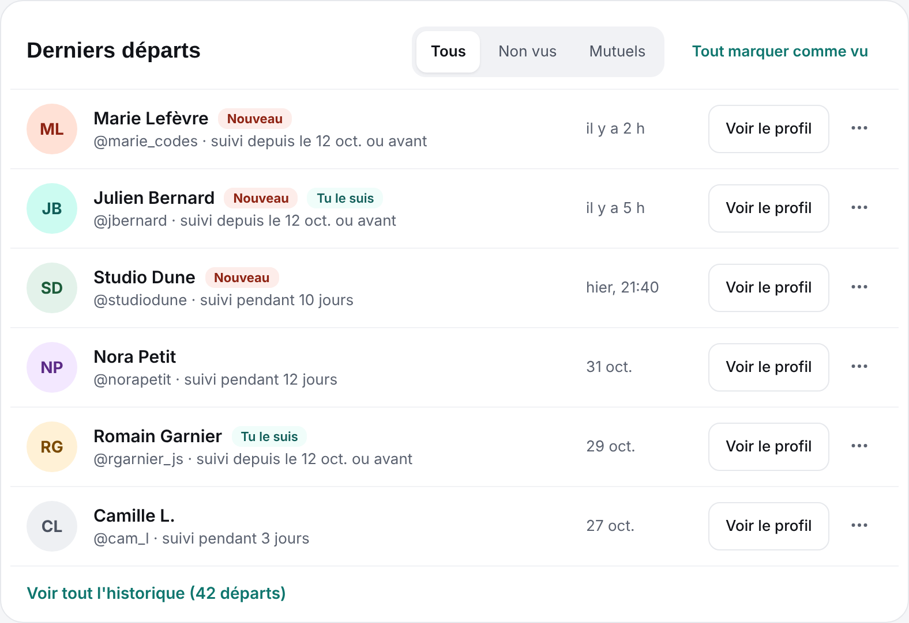
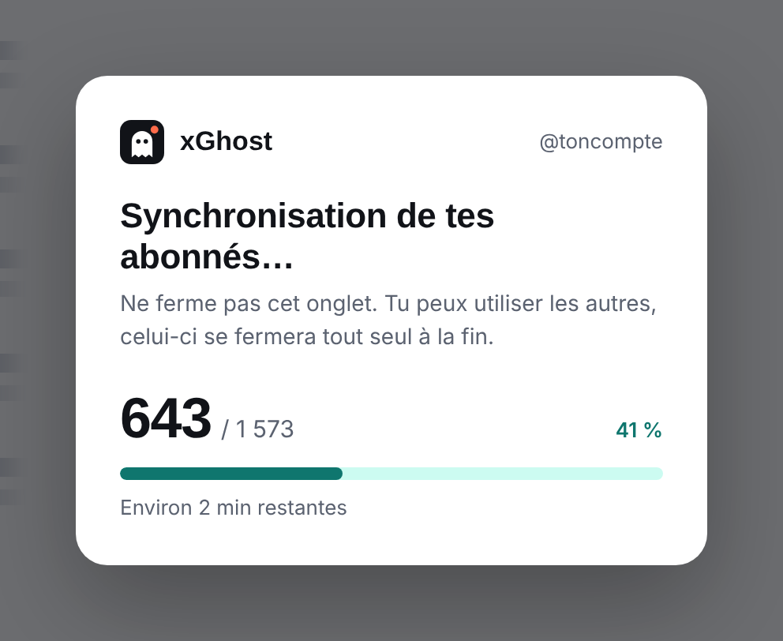

<p align="center">
  
</p>

<h1 align="center">xGhost</h1>

<p align="center">
  Détecte les comptes X qui ont arrêté de te suivre, et te prévient.<br />
  Extension pour Chrome et les navigateurs compatibles (Brave, Edge, Arc…).
</p>

<p align="center">
  <a href="https://app-buildr.github.io/xghost/"><strong>Site et guide d'utilisation</strong></a> ·
  <a href="https://app-buildr.github.io/xghost/en/"><strong>Website (English)</strong></a> ·
  <a href="https://chromewebstore.google.com/detail/xghost/igahhgiihlalnmlcdcaoeminiggaomin">Ajouter à Chrome</a>
</p>

<p align="center">
  
</p>

## Documentation

Tout est expliqué, captures à l'appui, sur le site de l'extension, en français et en anglais :

| 🇫🇷 Français | 🇬🇧 English |
| --- | --- |
| [Présentation](https://app-buildr.github.io/xghost/) : à quoi sert l'extension, en images | [Overview](https://app-buildr.github.io/xghost/en/): what the extension does, with screenshots |
| [Installation](https://app-buildr.github.io/xghost/#installation) : depuis le Chrome Web Store | [Install](https://app-buildr.github.io/xghost/en/#install): from the Chrome Web Store |
| [Mise à jour](https://app-buildr.github.io/xghost/#mise-a-jour) : automatique | [Updates](https://app-buildr.github.io/xghost/en/#updates): automatic |
| [Questions fréquentes](https://app-buildr.github.io/xghost/#questions) | [FAQ](https://app-buildr.github.io/xghost/en/#faq) |

## Fonctionnalités

> **À savoir :** xGhost ne peut pas faire de statistiques rétroactives. Il compte les départs et les
> arrivées à partir de son installation (le scan initial sert de référence) ; les unfollows
> antérieurs ne sont pas visibles.
>
> **Comptes jusqu'à 15 000 abonnés.** Au-delà, la synchronisation n'est pas lancée. Un compte déjà
> suivi peut grandir jusqu'à 20 000 abonnés ; au-delà, les vérifications s'arrêtent (l'historique
> reste consultable) et reprennent si le compte repasse sous cette limite.

- **Départs** : la liste des comptes qui ont arrêté de te suivre, avec la date. Un départ garde
  l'étiquette « Nouveau » jusqu'à ce que tu quittes la page.
- **Nouveaux abonnés** : les arrivées, dans un panneau à part. Les deux listes se filtrent sur les
  **follow back** (les comptes que tu suis aussi).
- **Graphiques** de 24 h à tout l'historique : arrivées et départs, solde, abonnés, durée de suivi.
- **Vérifications automatiques** : xGhost contrôle tes abonnés à intervalles réguliers, sans que tu
  aies à y penser. **Vérifier maintenant** lance un contrôle à la demande.
- **Alertes** : un badge sur l'icône et une notification groupée par vérification.
- **Plusieurs comptes** : chaque compte X connecté est suivi séparément, avec ses propres départs.
  Des comptes peuvent être ignorés, et « Uniquement les follow back » se règle compte par compte.
- **Historique complet**, gardé sur ton ordinateur.
- **Sauvegarde** : exporte toutes tes données dans un fichier, et réimporte-les après une
  réinstallation ou sur un autre ordinateur (Réglages → Sauvegarde).
- **Français et anglais**, selon la langue de ton navigateur.
- **Sans API ni serveur tiers** : xGhost lit ce que x.com affiche dans un onglet, avec ta propre
  session. Tes autres onglets x.com ne sont pas touchés, et rien ne quitte ton navigateur.
- **Mises à jour automatiques**, par le Chrome Web Store.

| Popup | Pendant un scan complet |
| :---: | :---: |
|  |  |

## Installation

1. Ouvre la [fiche xGhost sur le Chrome Web Store](https://chromewebstore.google.com/detail/xghost/igahhgiihlalnmlcdcaoeminiggaomin) et clique sur **Ajouter à Chrome**,
   puis confirme avec **Ajouter l'extension**. Fonctionne aussi sur Brave, Edge et les navigateurs
   basés sur Chromium, sur ordinateur.
2. Épingle l'icône : pièce de puzzle à droite de la barre d'adresse, puis l'épingle à côté de xGhost.
3. La page de démarrage s'ouvre. Connecte-toi à [x.com](https://x.com/login) si ce n'est pas déjà
   fait, puis choisis une **nouvelle synchronisation** ou **importe ta sauvegarde**.

## Mise à jour

Comme toutes les extensions du Chrome Web Store, xGhost se met à jour tout seul. Ton historique, tes
comptes et tes réglages sont conservés d'une version à l'autre. Pour être tranquille, exporte une
sauvegarde depuis les réglages (Réglages → Sauvegarde).

## Confidentialité

- Aucune donnée envoyée à un serveur tiers : pas de compte xGhost, pas d'API payante.
- Aucune requête maison vers X, aucun cookie conservé (xGhost vérifie seulement que tu es connecté).
- Toutes les données restent sur ton ordinateur (stockage local de l'extension). Rien n'est
  synchronisé : pour les garder ou les transférer, utilise l'export de sauvegarde. Le fichier
  contient la liste de tes abonnés, garde-le pour toi.
- Aucune autre connexion : xGhost ne parle qu'à X (x.com, et son serveur d'images pour les photos
  de profil).

xGhost est un outil non officiel, sans lien avec X Corp.

---

# Développement

Extension Chrome Manifest V3 en TypeScript, construite avec [WXT](https://wxt.dev), interface en
React.

## Démarrer

```bash
pnpm install
pnpm dev        # Chrome avec l'extension chargée et rechargement à chaud
```

## Commandes

| Commande         | Rôle                                                       |
| ---------------- | ---------------------------------------------------------- |
| `pnpm dev`       | mode dev (WXT), rechargement à chaud                       |
| `pnpm build`     | build de production dans `dist/`                           |
| `pnpm release`   | archive `release/xghost-<version>.zip` (script local `release.sh`) |
| `pnpm test`      | tests unitaires (Vitest)                                   |
| `pnpm test:browser` | tests de mise en page, dans le Chrome installé (Vitest) |
| `pnpm typecheck` | vérifie les types                                          |
| `pnpm lint`      | ESLint : promesses, hooks, frontières entre modules        |
| `pnpm icons`     | régénère les icônes PNG (normale, scan, déconnecté)        |

Charger le build à la main : `chrome://extensions` → mode développeur → « Charger l'extension non
empaquetée » → `dist`.

Le site (`docs/`) est publié par GitHub Pages (branche principale, dossier `/docs`). Version
française : `docs/index.html` ; version anglaise : `docs/en/index.html`, avec ses visuels dans
`docs/assets/images/en/`. Les deux pages partagent `docs/style.css` : toute modification de contenu
se fait dans les deux.

## Publier une nouvelle version

`main` est protégée : on n'y pousse pas directement, tout passe par une pull request.

1. Monte la version dans `package.json` (elle devient celle du manifeste), par exemple `1.0.1`, sur
   une branche, ouvre une pull request et fusionne-la. Reviens ensuite sur `main` à jour.
2. `pnpm release`, depuis `main` : vérifie les types et les tests, puis produit
   `release/xghost-<version>.zip`, avec `manifest.json` à la racine. `release.sh` est un script
   local, ignoré par git. La CI (`.github/workflows/ci.yml`) vérifie types, lint, tests et build sur
   chaque pull request et chaque mise à jour de `main`.
3. Envoie l'archive dans la [console développeur du Chrome Web Store](https://chrome.google.com/webstore/devconsole)
   et soumets la nouvelle version à la validation. Chrome met ensuite les extensions installées à
   jour tout seul.

La mise à jour maison (installation en mode développeur, vérification des releases GitHub, flèche ↑
sur l'icône) reste dans l'historique git, au commit `070f97c`, au cas où.

## Architecture (par fonctionnalité)

```
src/
├── entrypoints/           # WXT : background, scripts x.com (page + isolé), popup, options, onboarding
├── domain/                # règles pures : comparaison, événements, comptes (ni Chrome, ni stockage)
├── features/
│   ├── x-api/             # session (cookies), lecture et validation des réponses GraphQL de x.com
│   ├── followers-sync/    # moteur de scan (`scan-*.ts`), instantanés, profils, estimation du temps restant
│   ├── hidden-render/     # rendu simulé de l'onglet de scan quand il est caché
│   ├── scan-veil/         # overlay de l'onglet de scan (favicon de progression)
│   ├── unfollow-detection/# exploitation des scans, garde-fous, réparation et nettoyage de l'historique
│   ├── events/            # historique, commandes + listes départs/arrivées (ui/)
│   ├── accounts/          # comptes suivis (multi-comptes), comptes ignorés
│   ├── settings/          # réglages (modèle, stockage, interface)
│   ├── scheduler/         # alarmes, choix du scan à lancer, ajout automatique des comptes
│   ├── alerts/            # badge/icône et notifications
│   ├── backup/            # sauvegarde : export, validation stricte, import atomique, verrou
│   ├── app-state/         # hooks React d'accès aux données (état global, compte, « vu à l'affichage »)
│   ├── scan-status/       # textes et composants d'état du scan partagés
│   ├── stats/             # chiffres et graphiques du tableau de bord
│   └── dashboard/ popup/ options/ onboarding/   # écrans
└── shared/                # stockage local (+ conversion des sauvegardes 1.0), i18n, messagerie typée, composants, utilitaires
```

Le service worker est le seul à écrire (règle ESLint sur les fonctions d'écriture). Les interfaces
lisent le stockage directement et envoient leurs commandes par messages typés
(`shared/messaging/protocol.ts`), acceptés uniquement depuis les pages de l'extension.

Tout est dans `chrome.storage.local` (la synchronisation Chrome, limitée à 100 Ko, a été
abandonnée). Les grosses valeurs (historique, profils, scan en cours) sont stockées en texte JSON ;
les deux formats sont lus, et le fichier de sauvegarde ne change pas. Pas de migration automatique des données de la 1.0 : on les récupère en réimportant
une sauvegarde 1.0, convertie à l'import (`shared/storage/legacy.ts`).

## Traductions

Les textes sont dans `src/shared/i18n/locales/<langue>/*.json` (un fichier par domaine), traduits
avec [i18next](https://www.i18next.com) : `t('clé', { variables })`, pluriels `_one` / `_other`.
La langue suit celle du navigateur (anglais par défaut). Les clés sont typées sur le français, un test
vérifie que l'anglais a les mêmes clés et variables, et un autre qu'aucun texte n'est écrit en dur
dans le code. Nom et description de l'extension : `public/_locales`.

## Récupération des abonnés

xGhost ne fabrique **aucune requête** vers X (pas d'API, pas de forge d'en-tête anti-bot). Il ouvre x.com et lit les
réponses que la page reçoit elle-même.

- **Onglet de scan** ouvert avec un fragment (`SCAN_MARKER`) : seul cet onglet est instrumenté. Le
  script de page (monde MAIN) y lit les réponses `Followers`, `UserByScreenName` et `UserByRestId`, et
  les transmet au script isolé par un `MessageChannel` privé, échangé avant tout code de x.com. Le
  fragment n'est pas secret : le service worker, qui connaît l'onglet de scan par son id, confirme
  avant tout relais, et ailleurs le script de page retire ce qu'il a installé. Les autres onglets
  x.com ne sont pas touchés.
- **Contrôle léger** (« Vérifier maintenant », alarmes) : onglet épinglé en arrière-plan, sans défilement. Total annoncé
  + première page d'abonnés → arrivées, départs récents (comparés à l'ordre enregistré), écart
  restant.
  Total X en retard : nouvelle vérification 10 min plus tard.
- **Scan complet** (écart inexpliqué, « Scan complet », référence, contrôle tous les 10 contrôles
  légers) : onglet épinglé en arrière-plan avec overlay. S'arrête dès que les départs annoncés sont
  trouvés quand il est déclenché par un écart.
- **Couverture** : complet à 99 % du total X, ou si une reprise relit la liste sans rien ajouter (à
  partir de 90 %). Les départs trouvés doivent aussi être expliqués par la baisse du total X. Un scan
  incomplet n'est jamais comparé ; ses abonnés sont gardés pour « Continuer le scan ».
- **Nettoyage** : un lot de départs de même date revenu d'un coup est une erreur de scan des versions
  précédentes. Il est retiré de l'historique et conservé à part (`acc:<id>:repaired`).
- **Limite de X** (429, erreur 88, `x-rate-limit-remaining: 0`) : pause jusqu'à l'heure annoncée, puis
  reprise automatique.

## Limite d'abonnés

Seuils dans `src/features/accounts/limit.ts` : **15 000** pour un compte jamais synchronisé,
**20 000** pour un compte déjà suivi (la marge évite de couper un compte qui grandit ou dont le
total oscille). Le total testé est celui annoncé par X sur le profil, lu par le moteur avant tout
défilement (`onProfile`), et aussi d'après le dernier total connu au lancement d'une vérification.

- Au-delà : scan arrêté, onglet fermé, compte marqué `limit` ; départs en attente, nouveaux essais et
  reprises effacés. Icône grise avec « ! » si c'est le compte connecté.
- Compte jamais synchronisé : écran dédié dans l'onboarding (désinstaller, ou se connecter à un autre
  compte), aucun scan.
- Compte suivi : « Vérifier maintenant » et « Scan complet » désactivés. Les vérifications
  automatiques font seulement un contrôle léger (total relu, aucun défilement) ; si le total repasse
  sous 20 000, la limite est levée et tout reprend.

## Choix appliqués

1. Un départ est « vu » quand sa ligne est affichée (pas de bouton « marquer comme vu ») ; il garde
   l'étiquette « Nouveau » jusqu'à ce qu'on quitte la page.
2. « Suivre aussi mes abonnements » n'est pas prévu pour l'instant (réglage retiré).
3. Une notification groupée par passe de vérification des profils : un départ n'est notifié
   qu'une fois son profil vérifié (voir le point 6), ou après trois essais sans réponse, et
   seulement dans les 24 h qui suivent sa détection. Une vague de plus de 15 départs d'un coup est
   notifiée dès sa détection, en une fois.
4. Historique complet en local, sans synchronisation Chrome ; la sauvegarde (export/import) la remplace.
5. Les réglages sont globaux, sauf « Uniquement les follow back », propre à chaque compte.
6. Chaque départ est vérifié sur le profil du compte parti, ouvert dans l'onglet de scan juste
   après la détection (`followers-sync/follow-check.ts`). On y lit le follow back (le cache des
   profils, lu dans la liste des abonnés, peut dater du scan de référence) et si le compte suit
   toujours l'utilisateur : X cache parfois un abonné de la liste (compte restreint ou filtré). Ce
   faux départ est alors retiré de l'historique sans notification, et le compte est tenu pour
   présent (`acc:<id>:hidden`) jusqu'à son retour dans la liste, qui ne compte pas comme une
   arrivée. Ces abonnés cachés sont revérifiés après chaque scan complet : s'ils ne suivent plus
   l'utilisateur, le départ est enregistré et notifié ; un compte devenu suspendu ou supprimé est
   enregistré comme départ sans notification. L'action « Faux départ » du menu d'une ligne de
   départ fait la même chose à la main (annulable) : départ retiré, compte tenu pour caché, et sa
   vérification en file devient une revérification. Au passage à la 1.0.5, les départs des
   30 derniers jours encore affichés (100 au plus) sont revérifiés une fois, sans notification :
   ceux détectés avant la 1.0.4 n'ont jamais été confrontés à un abonné caché. Passes de 15 profils
   au plus, espacées de 15 min ; un scan est prioritaire, et les départs à vérifier passent avant
   ces revérifications. Les réponses lues restent en file jusqu'à leur application (arrêt du
   service worker), et une réponse servie par la session d'un autre compte est écartée. Le statut
   des comptes partis (suspendu, supprimé) n'est pas enregistré.
7. Chiffres sur 7 jours : bilan par compte (un départ suivi d'un retour ne compte pas).

8. Le bloc « Données » de la spec devient « Sauvegarde » (export/import complet au format JSON).
   L'export CSV et « Refaire le scan initial » ne sont pas implémentés.
